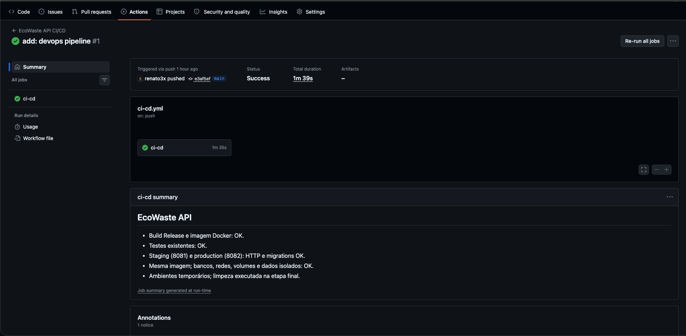
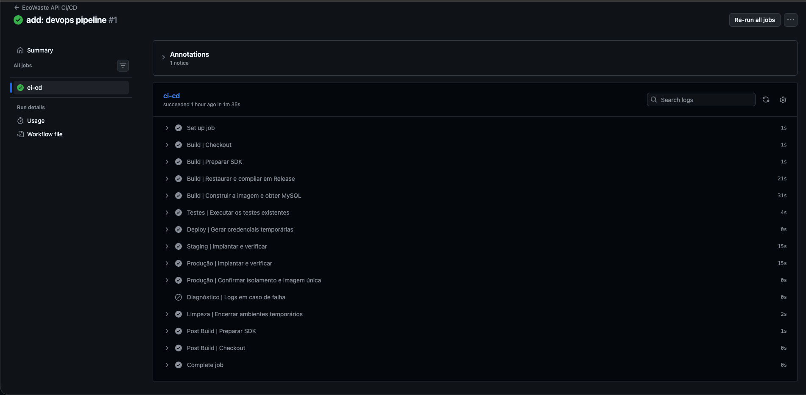
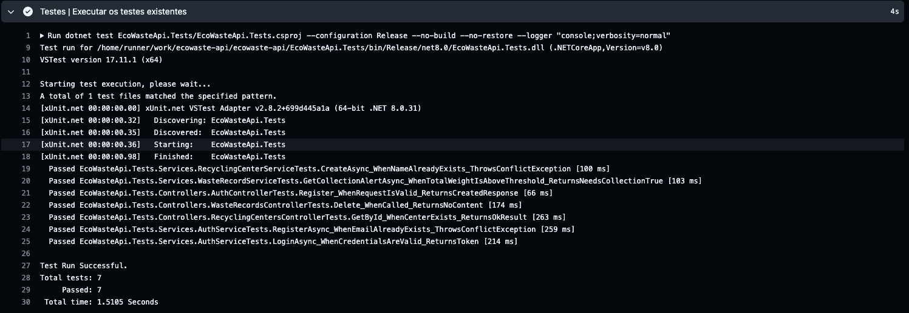
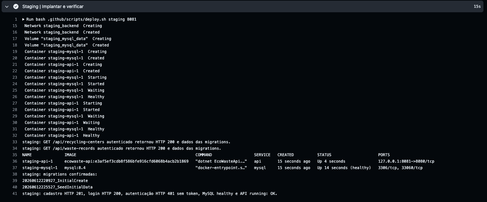
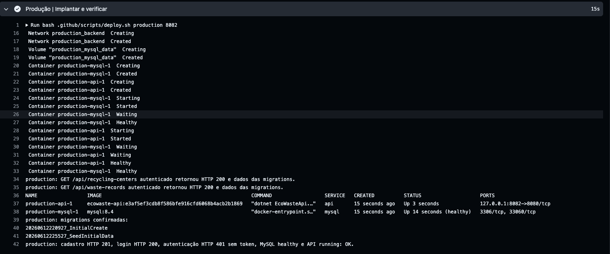

# EcoWaste API

## Apresentação do projeto

API REST para gestão de resíduos recicláveis e monitoramento ambiental, com foco em ESG. Permite cadastrar centros de reciclagem, registrar resíduos e acompanhar coletas, alertas de peso e relatórios. Cadastro de usuários e login utilizam JWT; exclusões exigem o perfil Admin.

A aplicação mantém as camadas de Controllers, Services, Repositories, Models, ViewModels, Data, Validators e Middlewares. As migrations existentes criam o esquema e inserem dados iniciais automaticamente na inicialização.

## Como executar localmente com Docker

Pré-requisito: Docker em execução com Docker Compose v2. Não é necessário instalar MySQL nem o SDK .NET no computador.

```bash
docker compose up --build -d
```

Aguarde o MySQL ficar saudável e a API aplicar as migrations. Acesse o Swagger em <http://localhost:8080/swagger> para cadastrar um usuário em `POST /api/auth/register`, fazer login em `POST /api/auth/login` e informar o `access_token` em **Authorize**. Consulte `GET /api/recycling-centers` para verificar a leitura dos dados iniciais.

Também é possível conferir a autenticação pelo terminal:

```bash
curl -i http://localhost:8080/api/recycling-centers
```

Sem token, o resultado esperado é HTTP 401. Essa resposta comprova o atendimento HTTP; a consulta autenticada pelo Swagger verifica também o acesso ao banco.

```bash
docker compose ps
docker compose logs --tail 100 api mysql
docker compose down
```

`down` preserva o volume do banco. `docker compose down --volumes` também apaga os dados desse ambiente. Se a porta 8080 estiver ocupada, use `API_PORT=18080 docker compose up --build -d` e acesse a porta escolhida.

As credenciais padrão do Compose destinam-se ao desenvolvimento local. Nenhum arquivo `.env` precisa ser criado. O Swagger é habilitado somente no contexto local `Development`, conforme o comportamento existente da aplicação.

### Endpoints principais

| Recurso | Endpoints |
| --- | --- |
| Autenticação | `POST /api/auth/register`, `POST /api/auth/login` |
| Centros de reciclagem | `POST` e `GET /api/recycling-centers`; `GET`, `PUT` e `DELETE /api/recycling-centers/{id}` |
| Registros de resíduos | `POST` e `GET /api/waste-records`; `GET`, `PUT` e `DELETE /api/waste-records/{id}` |
| Monitoramento | `GET /api/waste-records/alerts`, `GET /api/waste-records/report` |

Centros, resíduos e monitoramento exigem JWT. Os dois endpoints `DELETE` exigem Admin. As listas aceitam `page` e `page_size`; os campos JSON usam `snake_case`.

## Pipeline CI/CD

O [workflow único](.github/workflows/ci-cd.yml) do GitHub Actions executa em `push` na branch `main` ou manualmente pela aba **Actions**, sem parâmetros. Utiliza um único runner hospedado `ubuntu-latest` e somente a permissão `contents: read`.

1. **Build:** checkout, SDK definido em `global.json` (8.0.422), restore, build Release da solução e construção da imagem `ecowaste-api:<SHA do commit>` com o Dockerfile existente.
2. **Testes:** execução dos sete testes xUnit existentes em `EcoWasteApi.Tests`, com logs no console. Não há alterações nos testes.
3. **Staging:** Compose inicia o projeto `staging`, com API na porta 8081, banco `ecowaste_staging`, rede `staging_backend` e volume `staging_mysql_data`.
4. **Produção:** após o sucesso de staging, o projeto `production` inicia na porta 8082, com banco `ecowaste_production`, rede `production_backend` e volume `production_mysql_data`.

Os dois deploys usam a mesma imagem, sem recompilação. Senhas de banco e chaves JWT de 256 bits são geradas por ambiente com OpenSSL e mascaradas nos logs; não são necessários GitHub Secrets, variáveis ou GitHub Environments. Os ambientes são projetos Docker Compose chamados `staging` e `production`.

O [script compartilhado](.github/scripts/deploy.sh) evita duplicar as verificações. Aguarda o MySQL responder a uma consulta autenticada, aguarda HTTP 401 na rota protegida, registra um usuário, faz login e consulta centros e resíduos com JWT. Confere dados iniciais, todos os IDs de migrations em `__EFMigrationsHistory`, MySQL saudável, API em execução sem reinícios e ID da imagem. A etapa seguinte compara bancos, volumes e redes e exige HTTP 401 ao tentar usar o usuário de staging no banco de produção.

A espera do Compose tem limite de 180 segundos. A prontidão HTTP tem até 30 tentativas, com intervalo de 2 segundos e limite de 5 segundos por requisição. Demais requisições têm limite de 10 segundos. Qualquer erro impede as etapas posteriores; em caso de falha, o workflow mostra estados e os últimos 100 registros dos serviços. A limpeza sempre é tentada e remove os recursos dos dois projetos.

Os runners são temporários: os ambientes são implantados e verificados durante a execução, sem hospedagem permanente na internet. Os volumes persistem durante a existência dos ambientes e são removidos no encerramento do workflow.

Para executar os testes fora do Docker, com o SDK compatível instalado:

```bash
dotnet restore EcoWasteApi.sln
dotnet build EcoWasteApi.sln --configuration Release --no-restore
dotnet test EcoWasteApi.Tests/EcoWasteApi.Tests.csproj --configuration Release --no-build --no-restore --logger "console;verbosity=normal"
```

## Containerização

O Dockerfile utilizado foi preservado integralmente:

```dockerfile
FROM mcr.microsoft.com/dotnet/sdk:8.0 AS build
WORKDIR /src

COPY ["EcoWasteApi/EcoWasteApi.csproj", "EcoWasteApi/"]
RUN dotnet restore "EcoWasteApi/EcoWasteApi.csproj"

COPY . .
WORKDIR /src/EcoWasteApi
RUN dotnet publish "EcoWasteApi.csproj" -c Release -o /app/publish /p:UseAppHost=false

FROM mcr.microsoft.com/dotnet/aspnet:8.0 AS runtime
WORKDIR /app
COPY --from=build /app/publish .

ENV ASPNETCORE_URLS=http://+:8080
EXPOSE 8080

ENTRYPOINT ["dotnet", "EcoWasteApi.dll"]
```

O estágio `build` restaura e publica a API. O estágio `runtime` recebe somente a publicação e executa a aplicação com o runtime ASP.NET Core, sem incluir o SDK.

O [compose.yaml](compose.yaml) reúne `api` e `mysql` (MySQL 8.4). O MySQL armazena os dados em `mysql_data`; a rede bridge `backend` é própria de cada projeto Compose. O banco não publica portas no host. A API publica somente em `127.0.0.1` e depende da saúde do banco. Não há nomes fixos de contêineres.

| Variável | Uso / padrão local |
| --- | --- |
| `API_IMAGE` | Imagem da API; `ecowaste-api:local` |
| `API_PORT` | Porta local da API; `8080` |
| `ASPNETCORE_ENVIRONMENT` | `Development` local; `Production` nos dois deploys |
| `MYSQL_DATABASE`, `MYSQL_USER` | Banco e usuário; `ecowaste` |
| `MYSQL_ROOT_PASSWORD`, `MYSQL_PASSWORD` | Senhas locais de demonstração; aleatórias no CI/CD |
| `JWT_KEY` | Chave local de demonstração; aleatória em cada ambiente do CI/CD |

O Compose injeta `ConnectionStrings__DefaultConnection` e `Jwt__Key` pelos mecanismos nativos do ASP.NET Core. A API conecta com o usuário do banco, sem utilizar root. A seleção de projeto com `docker compose -p` separa contêineres, redes e volumes.

```bash
docker compose config --quiet
docker build --tag ecowaste-api:local .
```

## Prints do funcionamento

A primeira execução do workflow **EcoWaste API CI/CD**, `add: devops pipeline #1`, foi disparada por push na branch `main` (commit `e3af5ef`) e terminou com status **Success**, em **1 minuto e 39 segundos**. O build Release, a construção da imagem Docker e os **7 testes automatizados** foram aprovados.

Os deploys no runner confirmaram staging na porta 8081 e produção na porta 8082, MySQL 8.4 saudável, as duas migrations existentes e respostas HTTP 201 no cadastro, 200 no login e nas consultas autenticadas e 401 sem autenticação. Foram confirmados a mesma imagem nos dois ambientes e o isolamento de bancos, redes, volumes e dados. A limpeza dos ambientes temporários foi executada ao final.

**Visão geral — Status Success e resultados consolidados da execução.**



**Etapas — Build, testes, deploys e limpeza concluídos.**



**Testes — 7 testes xUnit executados e 7 aprovados.**



**Staging — Contêineres, migrations e validações HTTP na porta 8081.**



**Produção — Contêineres, migrations e validações HTTP na porta 8082.**



As capturas também estão incorporadas ao PDF `output/pdf/EcoWaste-API-DevOps.pdf` e incluídas no ZIP de entrega. No GitHub, a execução pode ser consultada na aba **Actions → EcoWaste API CI/CD → add: devops pipeline #1**. Os ambientes foram implantados e verificados no runner temporário, sem hospedagem permanente.

## Tecnologias utilizadas

- C# / .NET 8 e ASP.NET Core Web API.
- Entity Framework Core e Pomelo para MySQL 8.4.
- JWT Bearer, ASP.NET Core Identity (hash de senhas) e FluentValidation.
- Swagger / OpenAPI.
- xUnit, Moq e Microsoft.NET.Test.Sdk.
- Docker e Docker Compose v2.
- GitHub Actions, Bash, OpenSSL, curl e jq para o pipeline.
